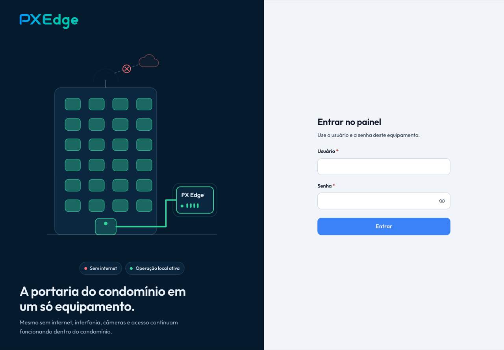
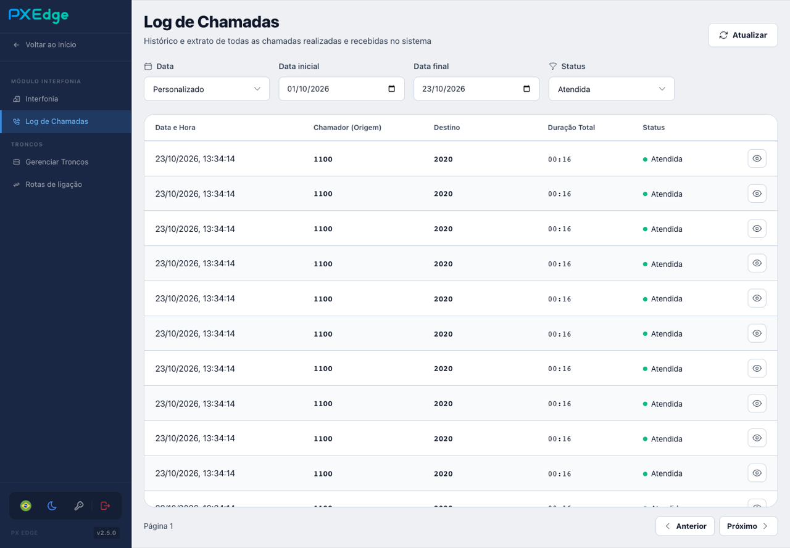
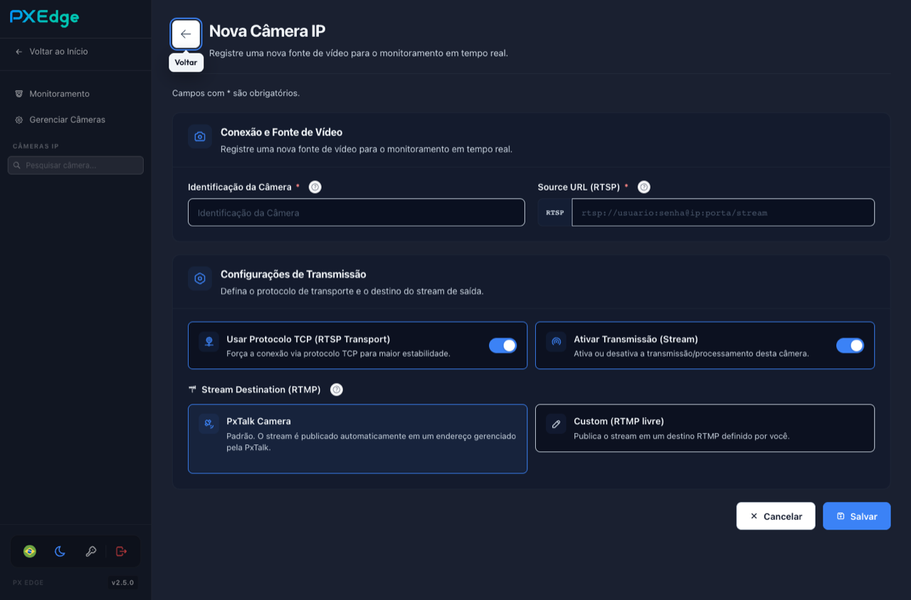
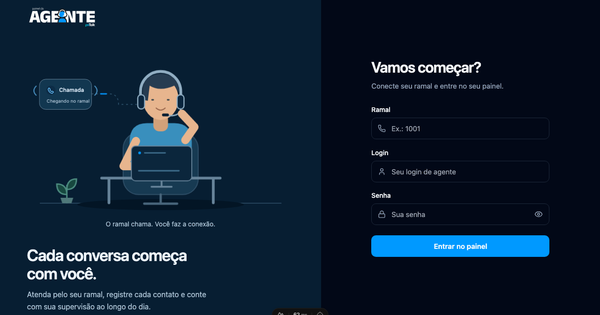

  
  
  
  

---

## 🧑‍💻 Sobre mim

- 💼 Desenvolvedor **Pleno** na **56k - Pxtalk**, em Matão - SP
- 📞 Trabalho com **telefonia na web**: softphones, **SIP**, **WebRTC** e integração com PBX (Asterisk)
- ⚡ No dia a dia: **TypeScript**, **Vue 3** e **Node.js**
- 📡 Desenvolvo o **PX Edge**, equipamento de portaria remota que funciona mesmo sem internet
- 🖥️ Também faço apps desktop com **Electron**
- 🌱 Estudando agora: **C# / .NET**, **SQL** e **BI**
- 📕 Nas horas vagas: leitura e natureza 🌲

---

## 🏢 O que eu construo na Pxtalk

### 📡 PX Edge

Equipamento *plug-and-play* para **portarias remotas de condomínios**. Junta num só aparelho o roteador, o PABX IP e o relay de câmeras, e continua funcionando **mesmo sem internet** (*offline first*). Interfonia, câmeras e acesso seguem ativos dentro do condomínio quando o link cai.

- Painel web que roda **dentro do próprio roteador MikroTik**, em containers
- **PBX IP** com Asterisk: ramais, troncos, rotas de ligação e log de chamadas
- **Câmeras IP**: proxy RTSP e envio do stream por RTMP
- Gestão de rede: WAN/LAN, firewall, failover entre dois links e VPN WireGuard

<table>
  <tr>
    <td colspan="2"></td>
  </tr>
  <tr>
    <td width="50%"></td>
    <td width="50%"></td>
  </tr>
</table>

**Stack:** Nuxt · Go · Asterisk · MikroTik RouterOS · MediaMTX · Caddy · WireGuard · SQLite

### ☎️ Pxtalk: módulo de Call Center

Plataforma de atendimento da Pxtalk, com três painéis: o do **agente**, que atende pelo próprio ramal, o do **gestor** e o **monitor de filas** em tempo real. Também inclui um SDK de eventos usado pelos painéis.

  

**Stack:** Nuxt · Fastify · Firebase · TypeScript · Playwright

---

## 🚀 Projetos open source

| Projeto | O que é | Stack |
| --- | --- | --- |
| 📦 **[easy-sipjs](https://github.com/phs-santos/easy-sipjs)** | SDK de softphone WebRTC/SIP publicado no [npm](https://www.npmjs.com/package/easy-sipjs). Você passa ramal, domínio e senha, e a biblioteca cuida de registro, reconexão, DTMF, qualidade de chamada e presença | TypeScript · SIP.js · Vitest |
| 🌈 **[Íris](https://github.com/phs-santos/iris)** | Softphone desktop para testar telefonia. Registra várias contas de vários PBX ao mesmo tempo e mostra o SIP de cada uma na mesma janela | Electron · Vue 3 · Pinia · easy-sipjs |

---

## 🛠️ Tecnologias e ferramentas

**Linguagens**

  
  
  
  
  
  

**Front-end e desktop**

  
  
  
  
  
  

**Telefonia e back-end**

  
  
  
  
  
  
  
  
  
  

**Ferramentas**

  
  
  
  
  
  

---

## 📊 Estatísticas

  
  
   
  

---

### 🖖 *Vida longa e próspera*

