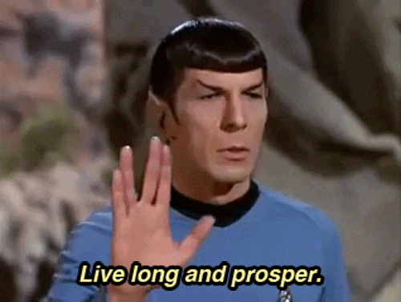

  
  
  

---

## 🧑‍💻 Sobre mim

- 💼 Desenvolvedor **Pleno** focado em **front-end**
- ⚡ Minha linguagem principal é **JavaScript**
- 🌱 Sempre aprendendo algo novo sobre **Vue**, **React** e **Node.js**
- 📕 Nas horas vagas: leitura e natureza 🌲
- 📫 Fale comigo pelo [LinkedIn](https://www.linkedin.com/in/paulo-souza-82a123248) ou [e-mail](mailto:paulo18santos2000@gmail.com)

---

## 🛠️ Tecnologias e ferramentas

**Front-end**

  
  
  
  
  
  

**Back-end**

  

**Ferramentas**

  
  
  

---

## 📊 Estatísticas

  
  
   
  

---

### 🖖 *Vida longa e próspera*

